# Лаба 4. Репликация PostgreSQL

Делали: Рекун Ирина, Костенко Кирилл, Ямалеева Азалия, К3320

Выбирать надо было между PostgreSQL и MongoDB. Я взяла Postgres, потому что он чаще попадается на работе, а мне хотелось научиться именно тому, что потом пригодится. Плюс там всё руками, и так понятнее, что вообще происходит. MongoDB, честно, тоже звучит прикольно, там можно работать с LLM, и когда-нибудь я её попробую, но пока что старый родной Postgres.

Запуск: `docker compose up -d --build` в этой папке. Сервис на localhost:8080, Prometheus на 9090, Grafana на 3000 (admin/admin).

## Сначала всё сломалось ещё до базы

У меня Windows с WSL2. Первым делом я начала вводить команды в PowerShell и получила ошибку на `mkdir -p`, потому что это команда для линукса. Открыла Ubuntu, но оказалась в `/mnt/c/...`, это диск C, и туда же склонировала репозиторий. Потом выяснилось, что так лучше не делать: у файлов с винды другие переводы строк, и скрипт в контейнере может не запуститься. Переклонировала в домашнюю папку линукса (`cd ~`).

Потом не получилось запушить, GitHub написал, что по паролю больше нельзя. Решила поставить `gh` и войти через браузер, но для установки нужен sudo, а пароль от WSL я вообще не помнила, кажется даже не ставила. Сбросила через `wsl -u root` и `passwd user`. После этого всё запушилось.

## Репликация

Сначала я вообще не понимала, что такое WAL и зачем нужен `pg_basebackup`. Понять получилось на примере с гугл-документом. Primary это автор, реплика это читатель с копией. Сначала читатель один раз скачивает весь документ целиком, это и есть `pg_basebackup`. Дальше ему приходят только правки, это WAL, журнал изменений, который Postgres ведёт всегда. Читатель сам писать не может, иначе его копия разъедется с оригиналом.

Я сначала перепутала и думала, что вся база гоняется каждый раз, а `pg_basebackup` шлёт изменения. На самом деле наоборот: копия целиком один раз в начале, а дальше постоянно идёт WAL.

В конфиге это выглядит так. На primary я включила `wal_level=replica` и `max_wal_senders`. Скрипт `primary/init.sh` при первом запуске создаёт пользователя `replicator` и разрешает ему подключаться в `pg_hba.conf`, без этого реплику не пустят. Реплика при старте, если папка пустая, делает `pg_basebackup ... -R`, а `-R` сам записывает, откуда брать WAL и что это реплика. Всё в `docker-compose.yml`, руками внутри контейнеров я ничего не запускала.

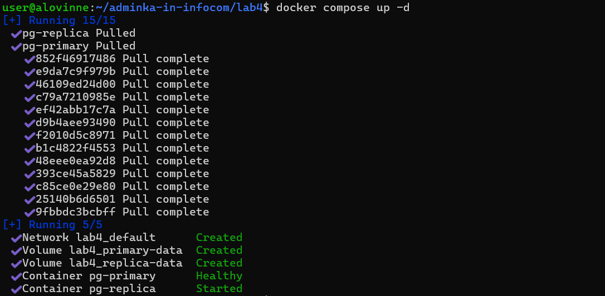

В логах реплики есть `started streaming WAL from primary`, значит работает.

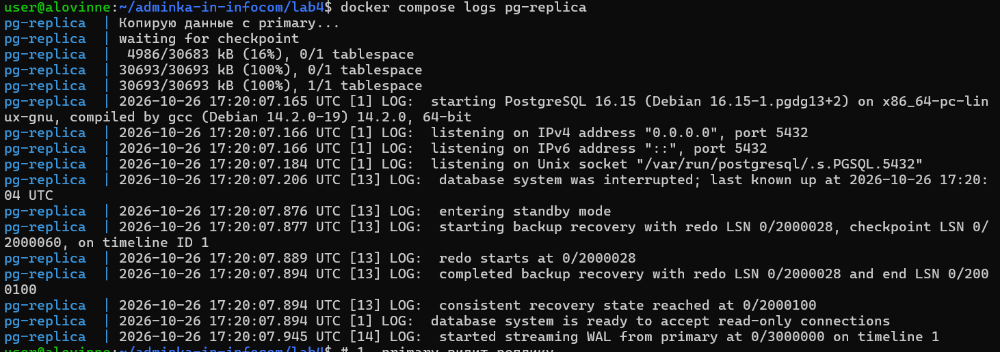

Потом проверила по пяти командам. Primary видит реплику со статусом `streaming`. Записала строчку в primary, она появилась на реплике. Попробовала записать в реплику и получила `cannot execute INSERT in a read-only transaction`, как и должно быть. И `pg_is_in_recovery()` на реплике вернул `t`, то есть она в режиме, когда применяет чужой журнал.

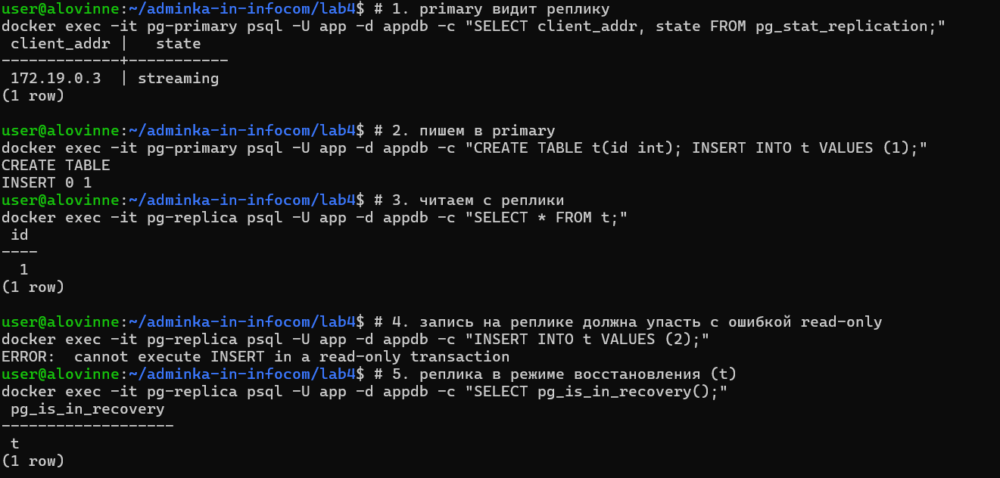

## Сервис

Сервис я сгенерировала с помощью AI, по заданию это можно. Там кнопка создать запись, кнопка налить нагрузку и список записей. Пишет он в primary, а читает с реплики. Сверху видно, сколько записей там и там.

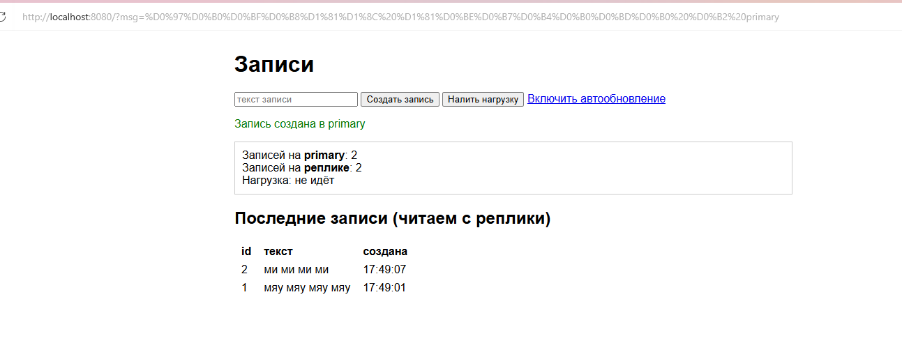

Адреса баз вынесены в переменные `PRIMARY_DSN` и `REPLICA_DSN`. Я сначала подумала, что это чтобы быстрее работало, но нет. Это чтобы потом, если база сломается, поменять одну строчку в compose и не лезть в код.

## Отставание реплики

Нажала «Налить нагрузку» с автообновлением и поймала момент: на primary 154003 записи, на реплике 148003. Новые записи на реплику доезжают не сразу.

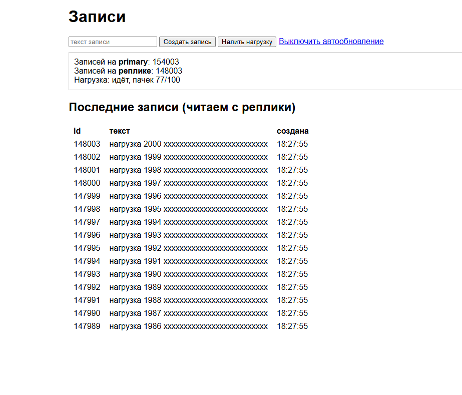

Это потому что репликация асинхронная. Primary записал у себя, сразу ответил «готово» и не ждёт реплику. Если записей много, она не успевает.

С замером сначала не получилось: скрин лага я сделала, а запрос запустить не успела, нагрузка уже кончилась. Налила ещё раз и тыкала стрелку вверх и Enter много раз подряд:

```sql
SELECT pg_wal_lsn_diff(pg_current_wal_lsn(), replay_lsn) AS lag_bytes, replay_lag
FROM pg_stat_replication;
```

Получилось до 1,3 МБ и до 0,27 секунды, потом 0. `lag_bytes` это сколько журнала реплика ещё не применила. Меня смутило, что `replay_lag` в конце не стал нулём, но это просто последнее значение, оно висит, пока не придут новые изменения.

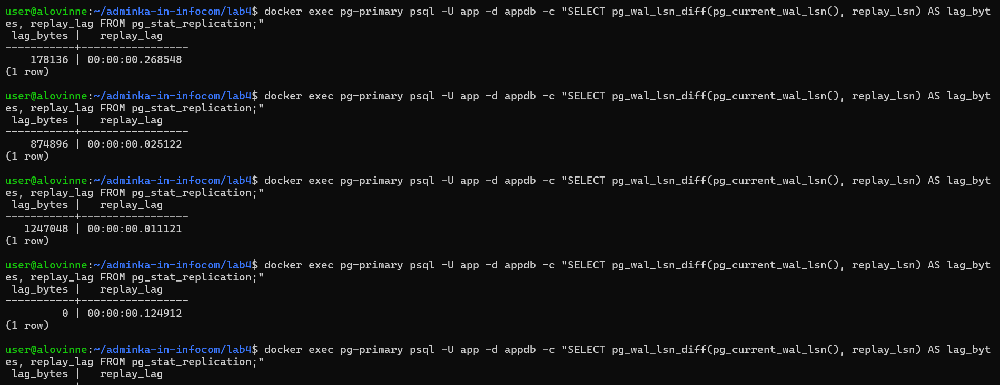

У меня лаг маленький, всё на одном компе. Но если представить: человек создал запись, обновил страницу, а записи нет. Он создаст её ещё раз, будет дубль. Или если это баланс после оплаты, вообще плохо.

## CAP

Моя схема ближе к доступности. Запись всегда проходит, реплика всегда отвечает, но иногда старыми данными, я это видела. То есть согласованностью жертвуем.

Если надо наоборот, можно включить синхронную репликацию:

```
synchronous_standby_names = '*'
synchronous_commit = remote_apply
```

Тогда primary ждёт, пока реплика применит изменение, и только потом отвечает. Минус в том, что запись медленнее, а если реплика упадёт, запись вообще зависнет, потому что primary будет ждать ответа, которого нет.

## Роняем primary

Сделала `docker stop pg-primary`. Список записей читается дальше (он же с реплики), primary пишет «недоступен», а записать ничего нельзя.

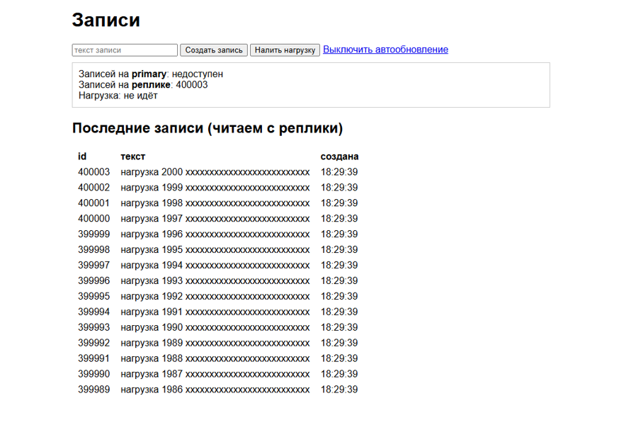

Повысила реплику командой `SELECT pg_promote();`, после этого `pg_is_in_recovery()` стал `f`. Дальше надо было переключить сервис, и я не поняла, как поменять `PRIMARY_DSN`. Сделала через sed, можно было и через nano. Перезапустила только сервис через `docker compose up -d --no-deps app`, `--no-deps` чтобы compose не поднял обратно старый primary.

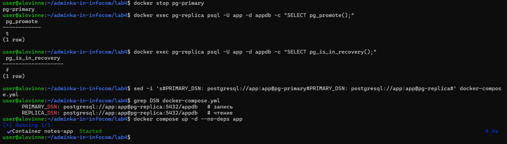

Запись заработала, записей 400005, ничего не пропало. Странно было, что id перепрыгнул с 400003 на 400030. Оказалось, Postgres берёт номера для id с запасом по 32 штуки, и при промоушене этот запас теряется. Номера пропали, записи нет.

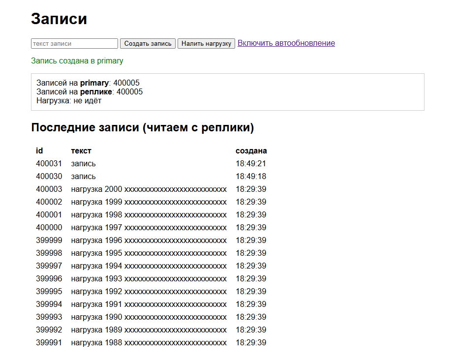

Если бы старый primary сейчас включился, было бы две главные базы, и если писать в обе, данные разойдутся. Это split-brain. Его надо не включать обратно, а делать заново репликой. В нормальных проектах это всё делают не руками, а через Patroni или repmgr, они сами переключают и не дают старому вернуться.

## Мониторинг

Перед мониторингом я всё снесла через `docker compose down -v`, потому что реплики после failover уже не было.

Поставила postgres_exporter на обе базы, Prometheus и Grafana. Ещё сделала свою метрику `lag_bytes`, это тот же запрос, что выше.

С мониторингом было тяжелее всего. Prometheus и Grafana выглядят так, что сначала вообще непонятно, что происходит: куча кнопок, меню, какие-то запросы, графики то пустые, то нет. Закошмарилась знатно, пока разобралась, где что смотреть.

Сначала экспортер primary был красный, ошибка 500. По логам оказалось, что он запустился раньше Postgres и не смог подключиться, а потом сам переподключился. Обновила страницу, и всё стало UP.

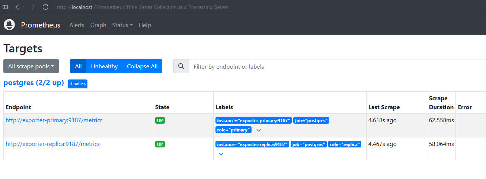

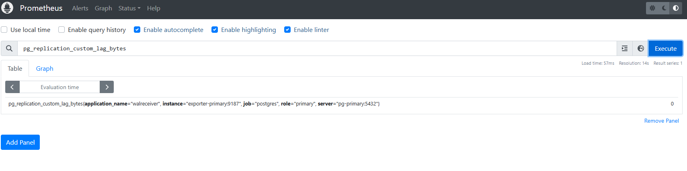

В Grafana я долго не могла найти, где переключиться с Builder на Code, а потом панель показывала No data. Это было из-за времени: стоял период с 16 до 20, а данные пошли только с 22. Поставила последние 15 минут, и график появился. Ещё не сразу нашла, как сохранить дашборд, это значок дискеты. И скрины Windows сохраняла не туда, где я искала, а в OneDrive.

На дашборде: живы ли базы, лаг в байтах и секундах, кто из них реплика, подключения, транзакции и вставки в секунду, размер базы. Во время нагрузки вставки дошли до 3600 в секунду, база выросла с 8 до 130 МБ, лаг подскочил до 4 МБ и вернулся в ноль.

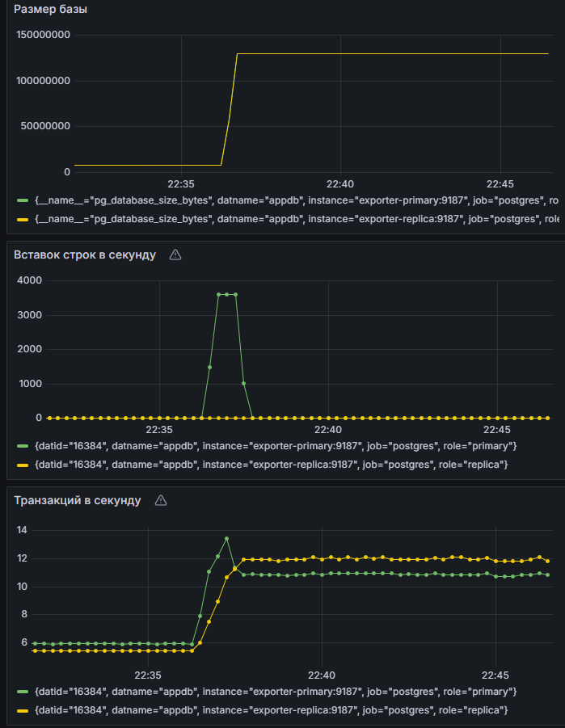

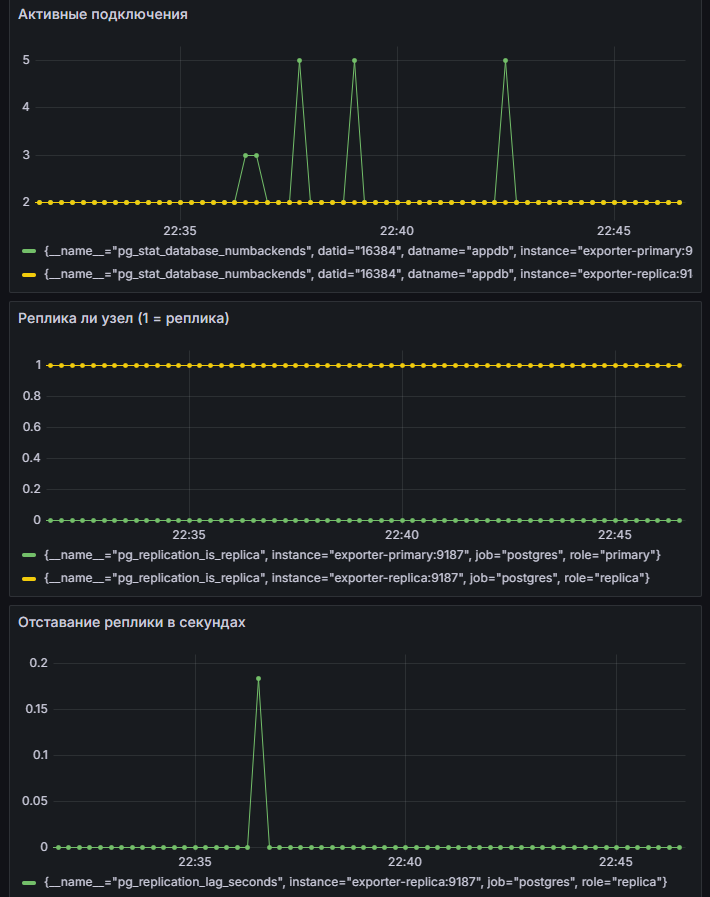

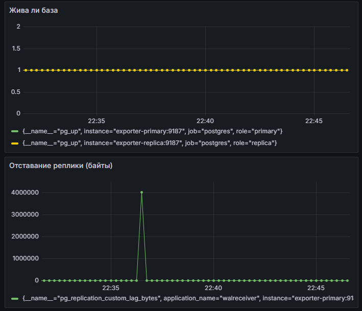

Для алертов я сначала выбрала «жива ли база», подключения, транзакции со вставками и «включена ли база». Потом поняла, что «жива» и «включена» это одно и то же, а транзакции для алерта плохие: они и так всё время скачут, днём больше, ночью меньше, непонятно, где порог. А про самое главное в этой лабе, отставание реплики, сначала забыла. В итоге:

1. `pg_up == 0` дольше 30 секунд. База лежит, запись или чтение не работает.
2. Лаг реплики больше 30 секунд дольше минуты. Люди видят старые данные, а если упадёт primary, потеряется то, что реплика не успела получить.
3. Подключений больше 80% от `max_connections`. Когда лимит кончится, новых клиентов просто не пустят.

## Что в итоге

Репликацию подняла, лаг увидела своими глазами, failover сделала руками. Больше всего времени ушло вообще не на Postgres, а на WSL, git, Grafana и поиск скринов. Зато теперь понятно, что такое WAL, а в начале я не знала.

Ещё эта лаба дала понять, что у меня отвратительная память. Я никак не могу запомнить, куда жать в Grafana и Prometheus, и каждый раз ищу одни и те же кнопки заново.
