# Лабораторная работа 4. Репликация базы данных

Выполнили: Рекун Ирина, Костенко Кирилл, Ямалеева Азалия, группа К3320

## Выбор СУБД

Мы выбрали **PostgreSQL**. Это самая распространённая реляционная СУБД в проде, и нам важно уметь с ней работать. Ещё в PostgreSQL репликацию и failover нужно настраивать вручную, поэтому лучше видно, как они устроены внутри.

## Как запустить

```bash
docker compose up -d --build
```

- сервис: http://localhost:8080
- Prometheus: http://localhost:9090
- Grafana: http://localhost:3000 (admin / admin), дашборд лежит в `monitoring/dashboard.json`

## Структура

```
lab4/
├── docker-compose.yml        # primary, реплика, сервис, мониторинг
├── primary/init.sh           # пользователь для репликации + pg_hba
├── app/                      # подопытный сервис (Flask) + Dockerfile
├── monitoring/
│   ├── prometheus.yml
│   ├── queries.yml           # своя метрика lag_bytes
│   ├── grafana/datasource.yml
│   └── dashboard.json
└── screenshots/
```

## Часть 1. Репликация через конфигурацию

Всё поднимается через `docker compose`, ручных команд в контейнерах нет.

**Primary** (`pg-primary`) запускается с параметрами:
- `wal_level=replica` — в WAL пишется достаточно информации для реплики;
- `max_wal_senders=5` — сколько реплик могут одновременно забирать WAL.

При первой инициализации выполняется `primary/init.sh`: он создаёт пользователя `replicator` с правом `REPLICATION` и добавляет в `pg_hba.conf` строку, разрешающую ему подключение для репликации. Без этой строки реплика не сможет подключиться, потому что `replication` — отдельный тип подключения.

**Реплика** (`pg-replica`) при первом запуске, пока папка данных пустая, делает полную копию primary через `pg_basebackup`:

```bash
pg_basebackup -h pg-primary -U replicator -D /var/lib/postgresql/data -R -X stream -P
```

Флаг `-R` создаёт `standby.signal` и прописывает `primary_conninfo`, поэтому Postgres стартует как реплика и знает, откуда брать WAL. `hot_standby=on` разрешает чтение с реплики.

Как это работает: `pg_basebackup` один раз копирует всю базу, а дальше primary передаёт реплике **поток WAL** (журнал изменений), и реплика применяет его у себя. Это streaming replication.

**Проверка:**

| Проверка | Результат |
|---|---|
| `SELECT client_addr, state FROM pg_stat_replication;` на primary | `state = streaming` |
| запись в primary, чтение с реплики | данные появились на реплике |
| `INSERT` на реплике | `ERROR: cannot execute INSERT in a read-only transaction` |
| `SELECT pg_is_in_recovery();` на реплике | `t` |

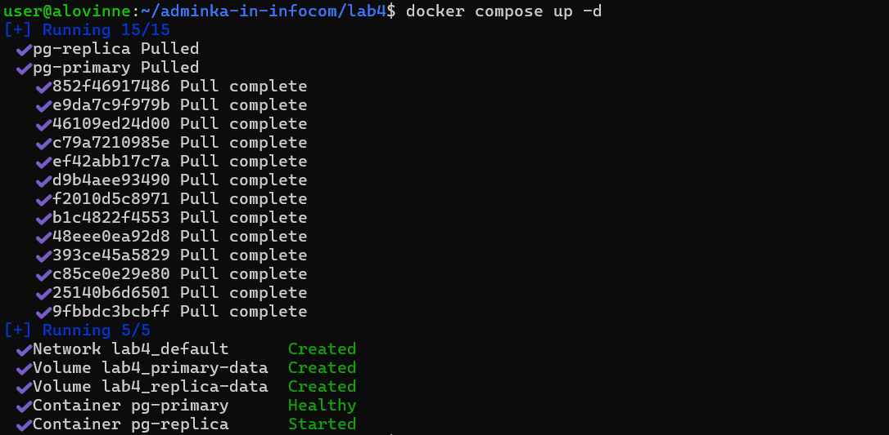

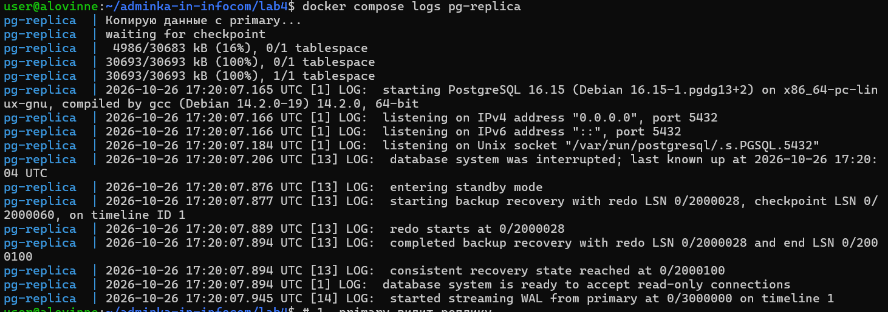

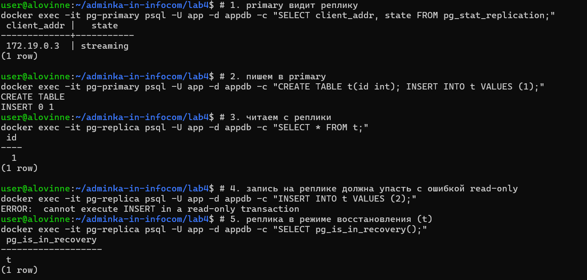

Реплика доступна только на чтение. Она всё время применяет WAL от primary, и если бы в неё можно было писать, данные разошлись бы.

## Часть 2. Сервис с read/write splitting

Сервис написан на Python (Flask), у него свой `Dockerfile`. На странице:
- **«Создать запись»** пишет в **primary**;
- **«Налить нагрузку»** пишет в **primary** 100 пачек по 2000 строк;
- список **«Записи»** читается с **реплики**;
- дополнительно показано число записей на primary и на реплике, чтобы был виден лаг.

Адреса баз вынесены в переменные окружения `PRIMARY_DSN` и `REPLICA_DSN` в `docker-compose.yml`. Так при failover можно переключить сервис на другую базу без правки кода.

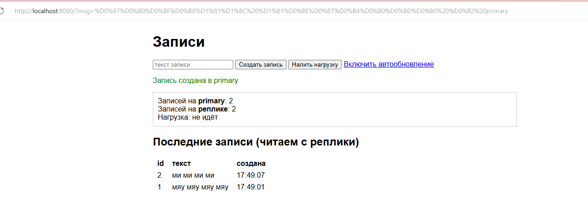

## Часть 3. Replication lag

Мы включили автообновление страницы и нажали «Налить нагрузку». Во время нагрузки **число записей на реплике было меньше, чем на primary**: на скриншоте primary — 154003 записи, реплика — 148003, то есть реплика отставала на 6000 строк (3 пачки).

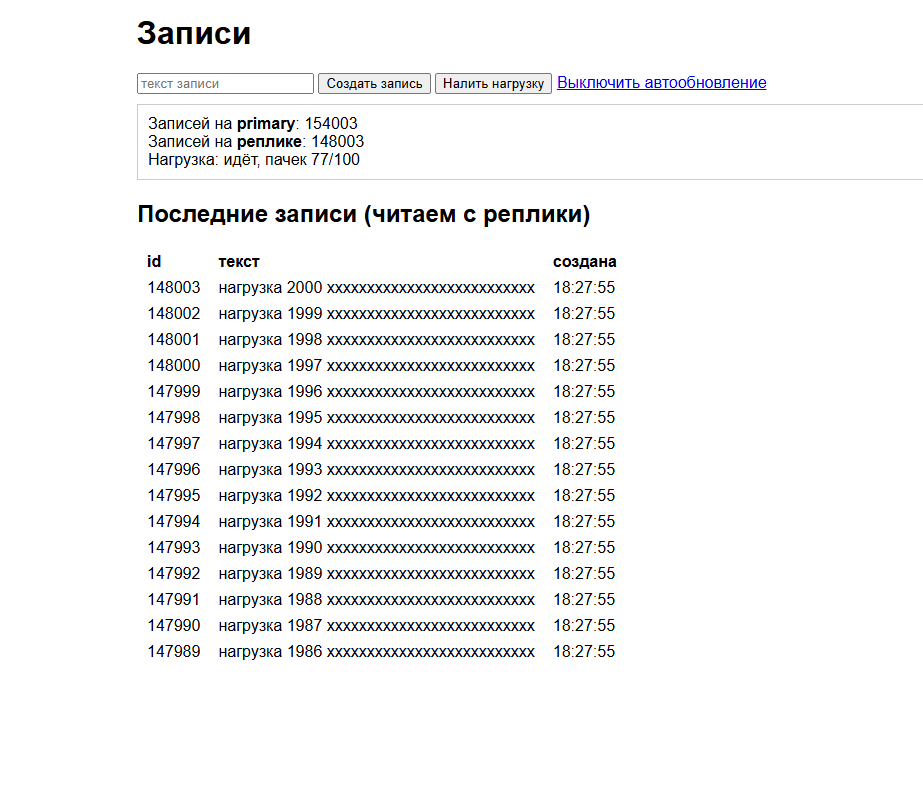

**Почему так происходит.** Репликация асинхронная: primary записывает изменение у себя и сразу отвечает клиенту, а реплика получает и применяет WAL чуть позже. Когда записей много, реплика не успевает и отстаёт.

**Как измерить.** На primary:

```sql
SELECT pg_wal_lsn_diff(pg_current_wal_lsn(), replay_lsn) AS lag_bytes, replay_lag
FROM pg_stat_replication;
```

- `lag_bytes` — сколько байт WAL реплика ещё не применила;
- `replay_lag` — отставание во времени.

Мои значения во время нагрузки:

| lag_bytes | replay_lag |
|---|---|
| 1 342 104 | 0.005 s |
| 178 136 | 0.27 s |
| 1 247 048 | 0.011 s |
| 0 (нагрузка закончилась) | — |

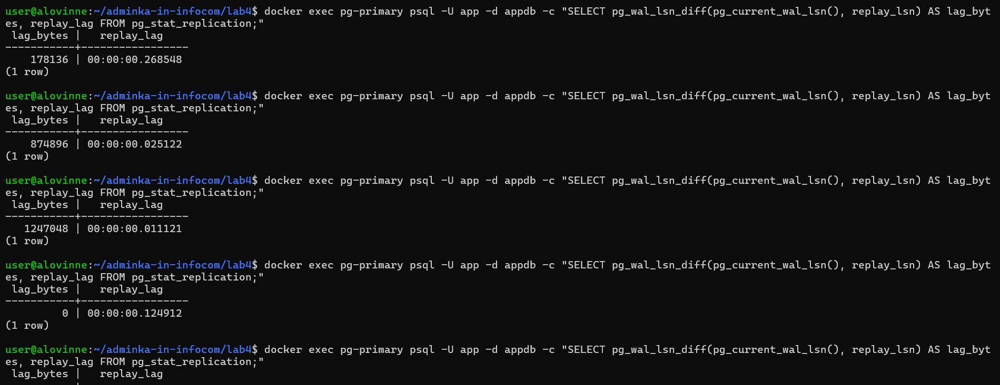

То есть реплика отставала до ~1,3 МБ WAL и до ~0,3 с, а после окончания нагрузки догнала primary. Локально лаг маленький, потому что обе базы на одной машине. В реальной сети и под большой нагрузкой он может быть секунды и больше.

**Чем грозит.** Пользователь создал запись, страница перечитала список с реплики, а записи нет. Он может решить, что запись не сохранилась, и создать дубль. Для критичных данных (баланс, статус заказа) устаревшее чтение может привести к неправильным решениям.

## Часть 4. Теорема CAP

Моя система сейчас **тяготеет к A (доступности)**. Репликация асинхронная: primary не ждёт реплику, запись всегда быстро проходит, а реплика всегда отвечает на чтение, даже если её данные устарели. Это я и увидела в части 3: система отвечает, но не всегда свежими данными. Согласованность (C) здесь принесена в жертву.

**Как сместиться к C:** включить синхронную репликацию на primary:

```
synchronous_standby_names = '*'
synchronous_commit = remote_apply
```

Тогда primary подтверждает запись, только когда реплика её применила, и чтение с реплики сразу видит новые данные.

**Чем за это платим:**
- запись становится медленнее: каждая транзакция ждёт ответа реплики;
- падает доступность: если реплика упадёт или пропадёт сеть, запись на primary **зависнет**, потому что подтверждения ждать неоткуда.

Ещё вариант — читать важные данные (например, сразу после записи) с primary, но тогда реплика меньше разгружает primary.

## Часть 5. Failover

1. Остановили primary: `docker stop pg-primary`.
   - чтение работало: список читается с реплики;
   - запись не проходила: primary «недоступен», а реплика принимает только чтение.

   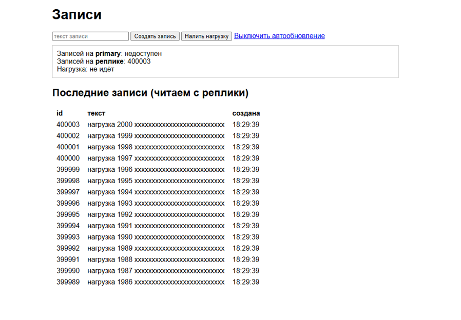

2. Повысили реплику до primary:
   ```bash
   docker exec pg-replica psql -U app -d appdb -c "SELECT pg_promote();"
   ```
   После этого `pg_is_in_recovery()` вернул `f`: узел вышел из режима восстановления и стал принимать запись.

3. Переключили сервис: в `docker-compose.yml` поменяли `PRIMARY_DSN` на `pg-replica` и перезапустила только сервис:
   ```bash
   docker compose up -d --no-deps app
   ```
   `--no-deps` нужен, чтобы compose не поднял заново упавший `pg-primary`.

   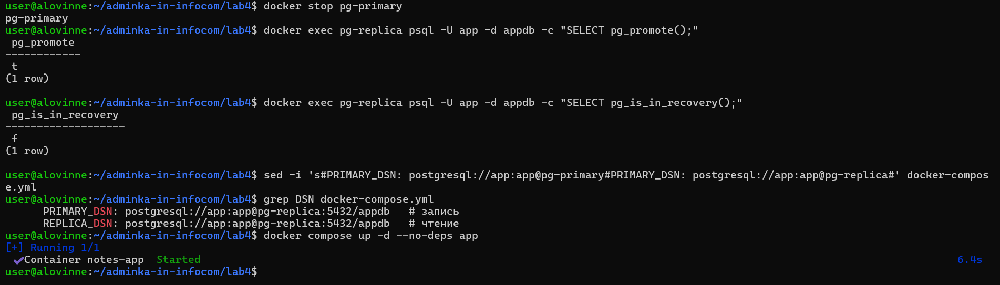

4. Запись снова проходит, данные не потерялись (400005 записей).

   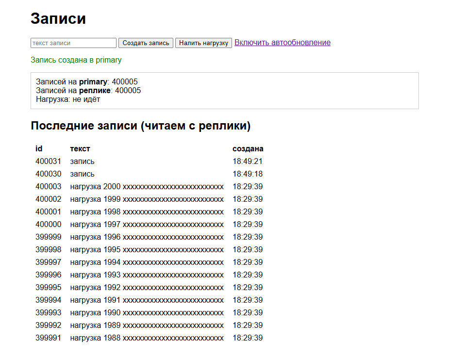

Интересный момент: id после failover перескочил с 400003 на 400030. Postgres записывает значения sequence в WAL с запасом (по 32), и при промоушене неиспользованный запас пропадает. Записи не потерялись, пропали только номера.

**Что было бы, если бы старый primary вернулся.** Он бы снова запустился как primary, и в системе оказалось бы два узла, принимающих запись. Если сервис пишет в оба, данные разойдутся: в каждой базе будут записи, которых нет в другой. Это **split-brain**. Старый primary нельзя просто включить обратно, его нужно пересоздать как реплику нового primary (через `pg_basebackup` или `pg_rewind`).

**Как это автоматизируют в проде.** Используют **Patroni** (вместе с etcd/Consul, через них узлы договариваются, кто primary) или **repmgr**. Они сами замечают падение primary, повышают реплику и не дают старому primary вернуться главным (fencing). Перед базами ставят HAProxy или виртуальный IP, чтобы сервис автоматически ходил на новый primary.

## Часть 6. Мониторинг

Postgres сам не отдаёт метрики в формате Prometheus, поэтому стоят два **postgres_exporter**: на primary и на реплике. **Prometheus** собирает с них метрики каждые 5 секунд, **Grafana** рисует дашборд.

Дополнительно мы добавили свою метрику `pg_replication_custom_lag_bytes` (`monitoring/queries.yml`). Это тот же запрос из части 3, который экспортер выполняет на primary.

**Панели дашборда:**

| Панель | Запрос | Зачем |
|---|---|---|
| Жива ли база | `pg_up` | видно, работает ли каждый узел |
| Отставание реплики (байты) | `pg_replication_custom_lag_bytes` | сколько WAL не применено |
| Отставание реплики (секунды) | `pg_replication_lag_seconds{role="replica"}` | насколько старые данные на реплике |
| Подключения | `pg_stat_database_numbackends{datname="appdb"}` | нагрузка на базу и запас до лимита |
| Транзакций в секунду | `rate(pg_stat_database_xact_commit{datname="appdb"}[1m])` | общая активность |
| Вставок строк в секунду | `rate(pg_stat_database_tup_inserted{datname="appdb"}[1m])` | видно нагрузку на запись |
| Реплика ли узел | `pg_replication_is_replica` | видно роль узла; после failover должна поменяться |
| Размер базы | `pg_database_size_bytes{datname="appdb"}` | рост данных; на primary и реплике совпадает |

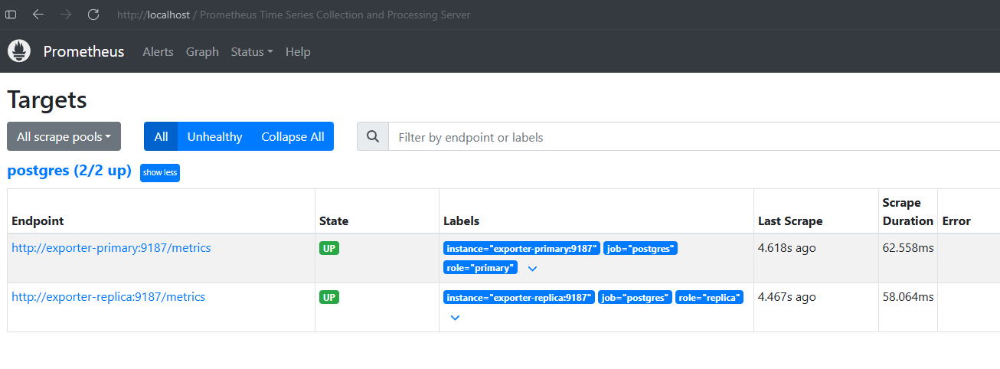

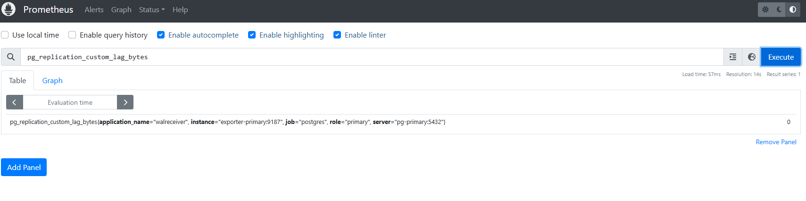

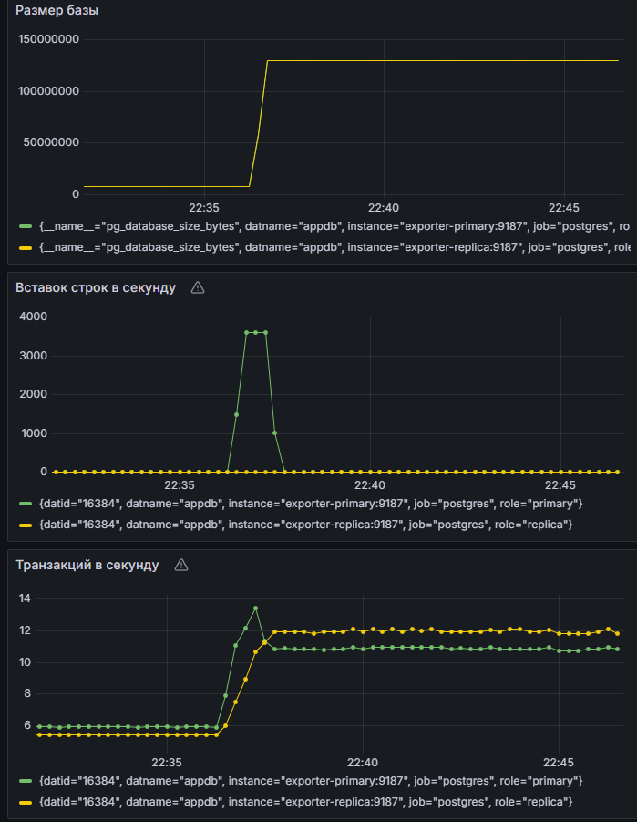

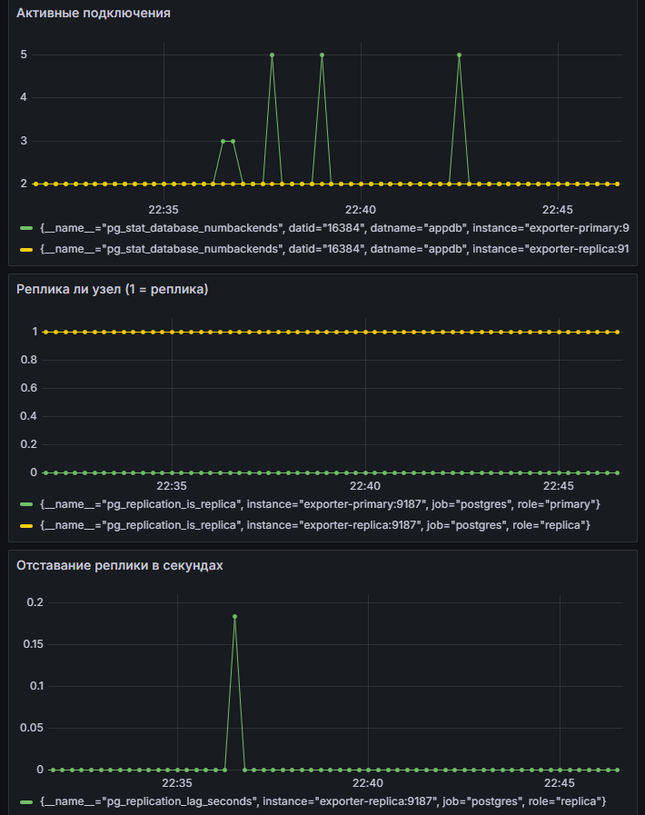

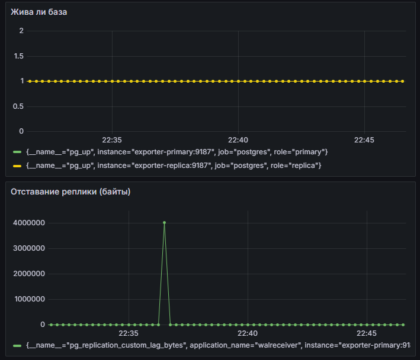

Во время нагрузки на дашборде видно: вставки выросли примерно до 3600 строк/с, размер базы вырос со ~8 МБ до ~130 МБ (на primary и реплике одинаково), отставание реплики подскочило до ~4 МБ и ~0,18 с, а потом вернулось к нулю.

### 3 метрики для алертов

1. **База недоступна:** `pg_up == 0` дольше 30 секунд. Самая критичная ситуация: если упал primary, не работает запись, если реплика — чтение. Нужно сразу реагировать, например делать failover.

2. **Отставание реплики:** `pg_replication_lag_seconds > 30` дольше 1 минуты. Пока реплика отстаёт, пользователи читают устаревшие данные (часть 3). Если лаг растёт и не уменьшается, значит, с репликой что-то не так: сеть, диск или она не справляется. А если в этот момент упадёт primary, при failover потеряется всё, что реплика не успела получить.

3. **Подключения близки к лимиту:** `sum(pg_stat_database_numbackends) / pg_settings_max_connections > 0.8`. Когда подключений станет `max_connections` (по умолчанию 100), новые клиенты будут получать ошибку и сервис для них сломается. Алерт на 80% даёт время разобраться до отказа.

Транзакции и вставки в секунду мы на алерт не ставим: они сами по себе сильно меняются (днём больше, ночью меньше), трудно выбрать порог, и алерт срабатывал бы на обычную работу. Их полезно видеть на дашборде.

## Вывод

Мы подняли streaming replication в PostgreSQL через конфигурацию docker compose, развели запись и чтение между primary и репликой и на живом примере увидели replication lag: во время нагрузки реплика отдавала устаревшие данные. Это пример уклона в сторону доступности по теореме CAP. Сместиться к согласованности можно синхронной репликацией, но ценой скорости и доступности записи. При падении primary запись перестала работать, и мы вручную повысили реплику через `pg_promote()`. В проде это автоматизируют, например, Patroni. Также настроили мониторинг через postgres_exporter, Prometheus и Grafana и выбрали 3 метрики для алертов: доступность базы, отставание реплики и число подключений.
