# Лаба 5. Elasticsearch и Kibana

Делали: Рекун Ирина, Костенко Кирилл, Ямалеева Азалия, К3320

Надо было поднять Elasticsearch с Kibana, залить логи, поискать по ним, понять, что значат цвета статуса кластера, настроить ротацию индексов и мониторинг.

Запуск: `docker compose up -d`. Эластик на localhost:9200, Kibana на 5601, Prometheus на 9090, Grafana на 3000 (admin/admin). Запросы я делала в Kibana, Dev Tools → Console.

## Запуск

Эластик ест много памяти, так что четвёртую лабу перед этим я выключила. В compose сказала ему, что он один (`discovery.type=single-node`), отключила пароли (`xpack.security.enabled=false`, для учёбы ок, в проде нельзя) и ограничила память Java одним гигабайтом.

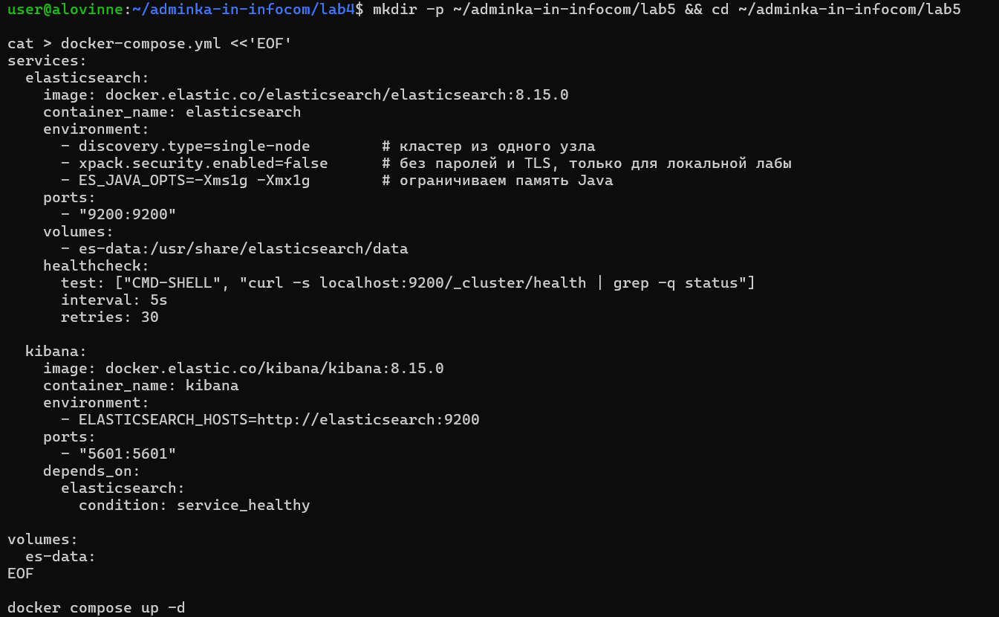

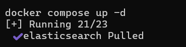

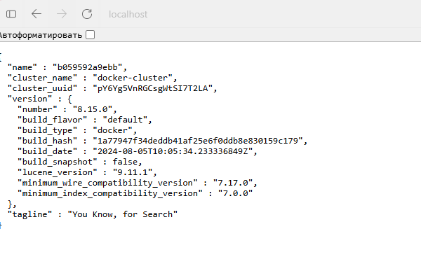

Kibana при первом входе показала «Welcome to Elastic» с интеграциями, и я не поняла, куда дальше. Надо было нажать Explore on my own и через меню найти Dev Tools.

## Почему green, а потом yellow

`GET _cluster/health` показал green и один узел.

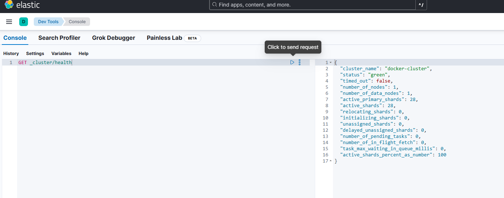

Чтобы посмотреть, как бывает по-другому, я создала `test-index`. Случайно нажала `PUT test-index` второй раз и получила ошибку, что такой уже есть, это не страшно. Статус стал yellow, один шард не размещён.

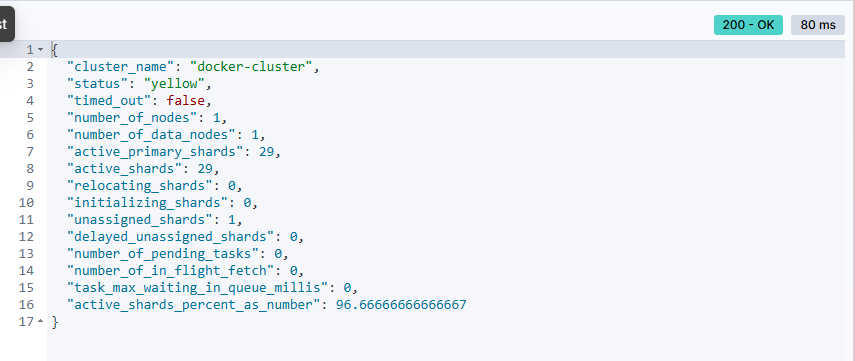

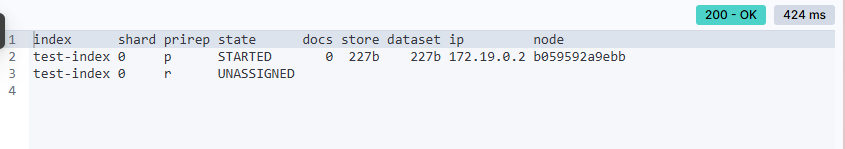

Основной шард работает, а реплика висит в UNASSIGNED. Эластик не кладёт копию на тот же узел, где оригинал, иначе если узел умрёт, умрут оба. А второго узла нет. Yellow значит, что данные есть, но без запасной копии. Red, если пропал сам основной шард. Чтобы стало green, по-нормальному надо второй узел. Можно поставить 0 реплик, но это только для локалки, я так и сделала у себя.

## Логи и маппинг

40 логов я сгенерировала с помощью AI: четыре сервиса, уровни INFO, WARN, ERROR, у части одинаковые trace_id. Файл `logs.ndjson`.

Маппинг: время это date, сообщение это text, уровень, сервис и trace_id это keyword. Text режется на слова, по нему ищут слово в тексте. Keyword хранится целиком, по нему точный фильтр и подсчёт групп.

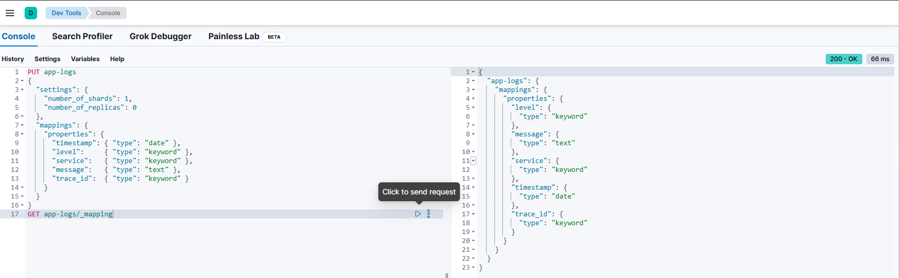

С заливкой пришлось повозиться. Вставила файл в консоль Kibana, а вставилась одна первая строчка, и эластик сказал `request body is required`. Решила через терминал, но два раза получила «No such file», потому что сидела не в той папке (`adminka-in-infocom` вместо `adminka-in-infocom/lab5`). В итоге так:

```bash
cd ~/adminka-in-infocom/lab5
tail -n +2 logs.ndjson | curl -s -X POST "localhost:9200/app-logs/_bulk" -H "Content-Type: application/x-ndjson" --data-binary @-
```

`tail` убирает первую строчку, она только для консоли. `_count` показал 40.

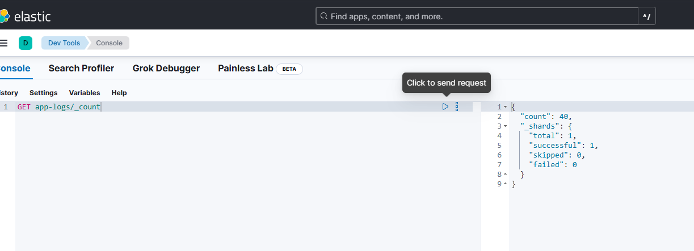

## Поиск

Слово timeout через `match` нашлось в 4 логах. Там у каждого `_score`, насколько подходит.


ERROR с 12 до 18 через `filter` нашлось 8. Я сначала думала, что filter и match ничем не отличаются. Оказалось, отличаются: match ищет слова и считает, насколько подходит, а filter просто да или нет, без оценки, поэтому быстрее. Для уровня и дат нужен filter.

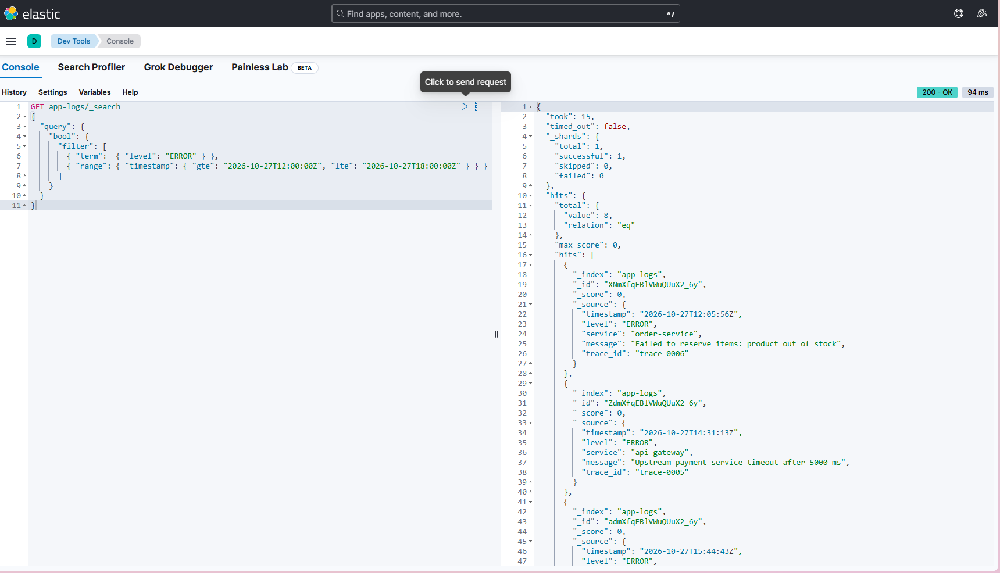

По trace-0002 нашлось 8 логов из разных сервисов, по времени видно, куда ходил запрос и где упал.

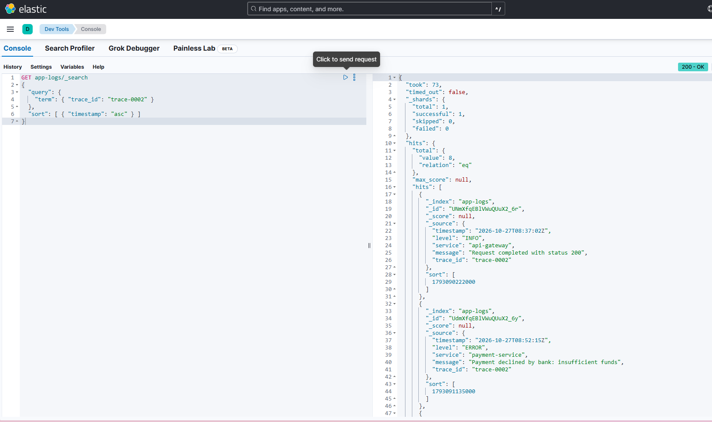

Агрегация по уровню: INFO 17, ERROR 14, WARN 9. Это как GROUP BY.

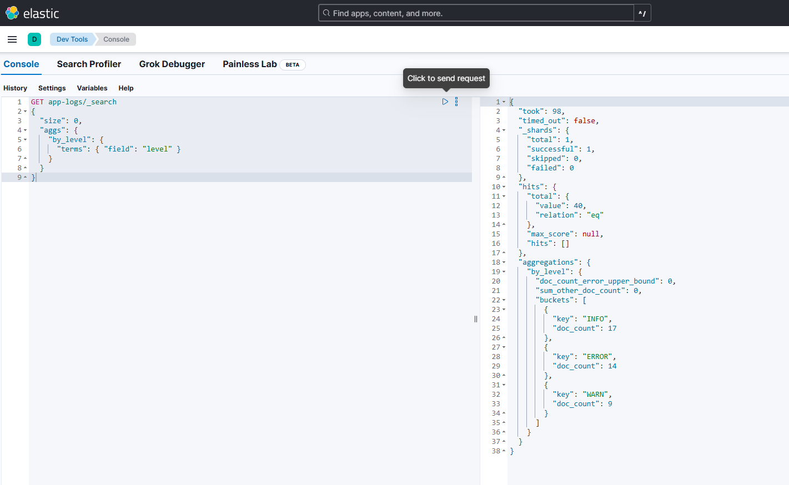

## Kibana

Сделала data view `app-logs*` (со звёздочкой, чтобы потом подхватить новые индексы). В Discover сначала был виден 1 документ из 40, потому что стояли последние 15 минут. Поставила Today, стало 40. Время там по Москве, а в логах UTC, поэтому сдвиг на 3 часа.

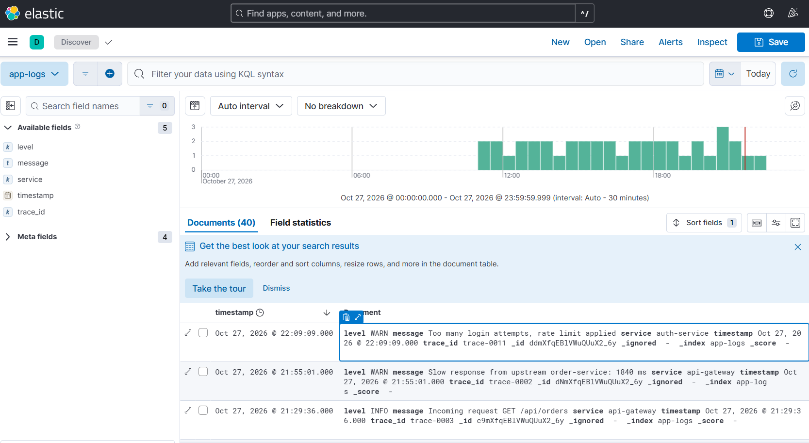

В Lens просто перетащила `level` в середину, и получились столбики.

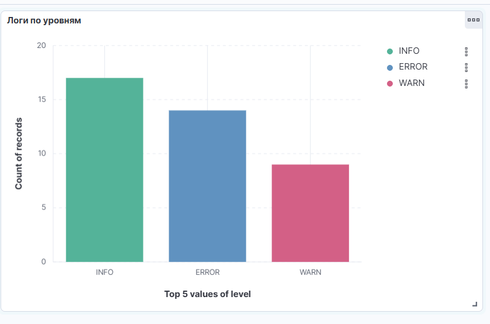

## Ротация индексов

Если всё писать в один индекс, он растёт бесконечно, а старое удалять долго. Поэтому делают так: индекс набрал сколько-то, создаётся новый (rollover), а старые удаляются по расписанию (ILM). Приложение пишет в alias, такой псевдоним, который всегда показывает на текущий индекс.

Политика: новый индекс после 10 документов, удаление через 30 минут. Порог маленький, чтобы быстро проверить.

```
PUT _ilm/policy/app-logs-policy
{
  "policy": {
    "phases": {
      "hot": { "actions": { "rollover": { "max_docs": 10, "max_age": "1d" } } },
      "delete": { "min_age": "30m", "actions": { "delete": {} } }
    }
  }
}
```

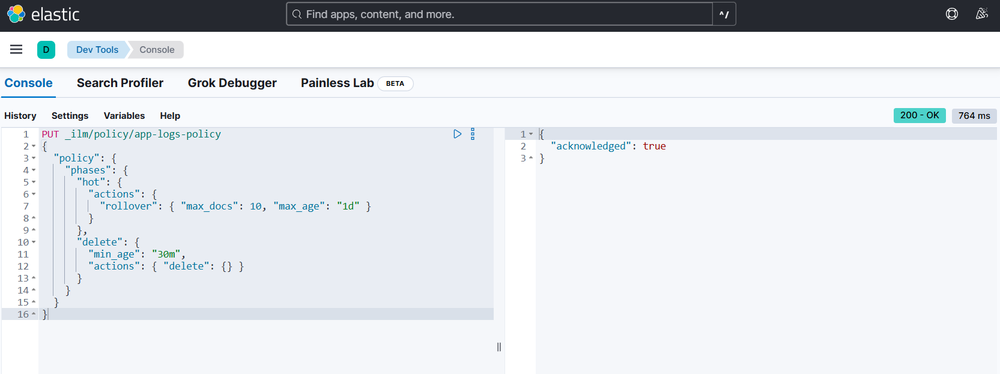

Проверку ILM я ускорила с 10 минут до 10 секунд.

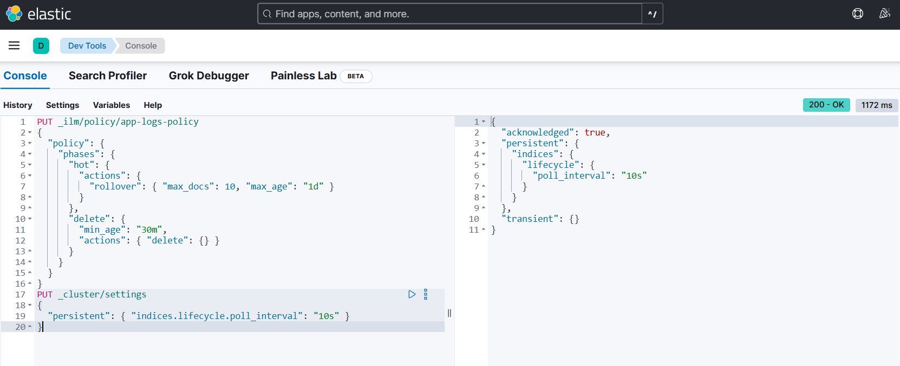

Шаблон на `app-logs-*`, чтобы каждый новый индекс сам получал маппинг и политику.

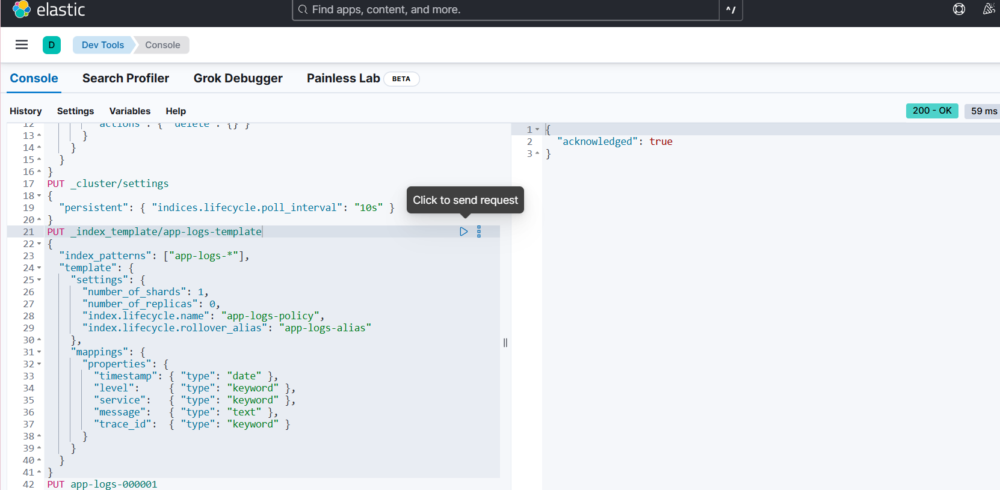

Первый индекс `app-logs-000001` с alias сделала руками.

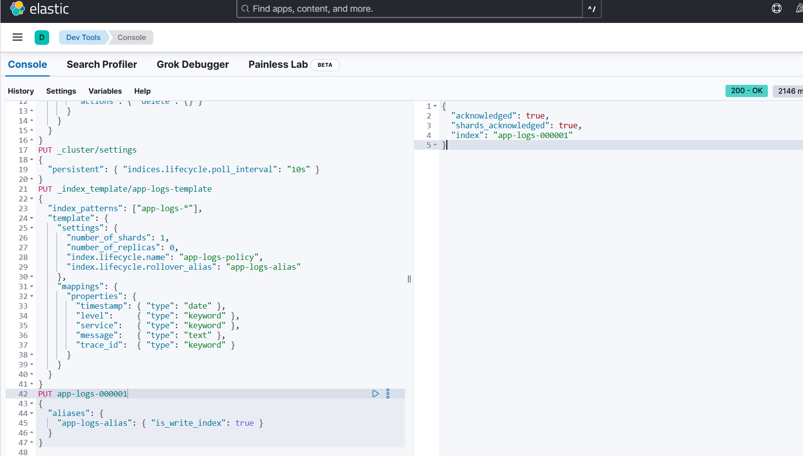

Залила логи в alias, жду, а нового индекса нет. В `_cat/indices` у `000001` стоит 0 документов, хотя я точно залила 40. ILM висел на `check-rollover-ready`.

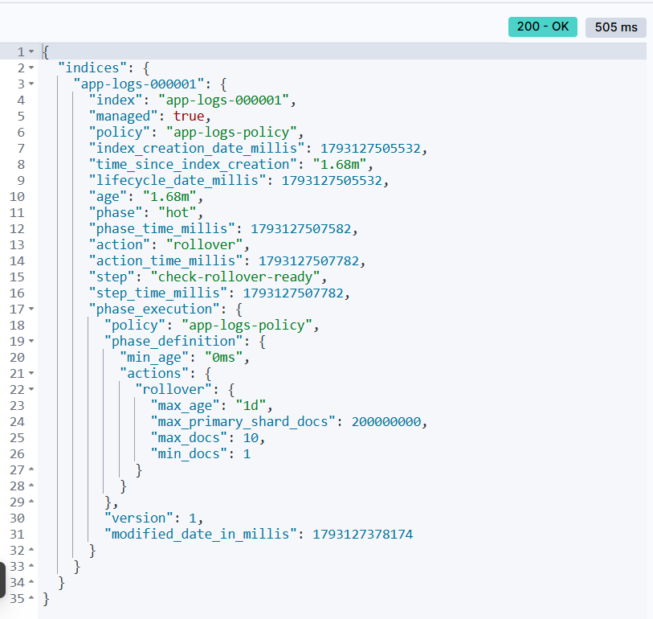

Причина: записанные документы видно только после refresh, а если индекс никто не ищет, эластик refresh откладывает. ILM видел 0 и ничего не делал. После `POST app-logs-alias/_refresh` стало 40, и через пару секунд появился `000002`.

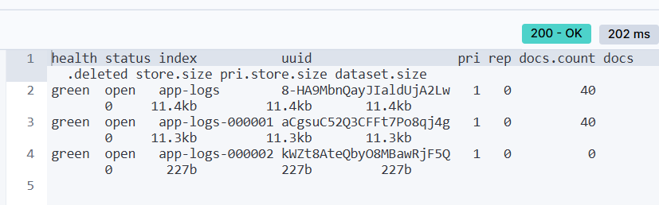

Alias теперь пишет в `000002`, а у `000001` стоит `false`.

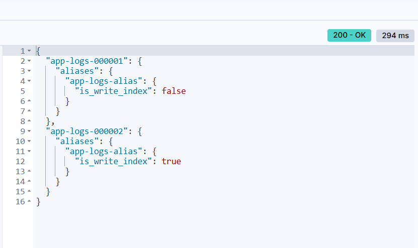

## Мониторинг

Поставила elasticsearch_exporter, Prometheus и Grafana, как в прошлой лабе. Хотя я с ними уже работала, всё равно было тяжело понять, что там вообще происходит, интерфейс у них очень запутанный. Сначала даже не поняла, где «делать метрики». Оказалось, экспортер их уже собирает, нужно только сделать панели в Grafana.

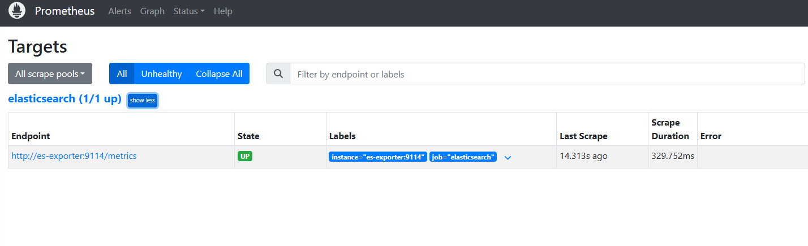

На дашборде статус кластера, неразмещённые шарды, heap, свободный диск, документы по индексам и скорость записи. С документами был затык: запрос `elasticsearch_indices_docs{index=~"app-logs.*"}` выдавал No data. Это метрика всего узла, по индексам нужна `elasticsearch_indices_docs_primary`.

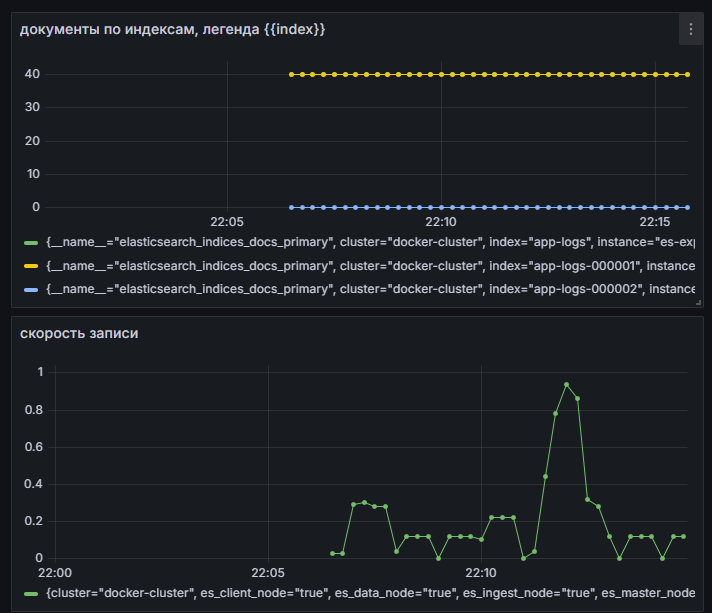

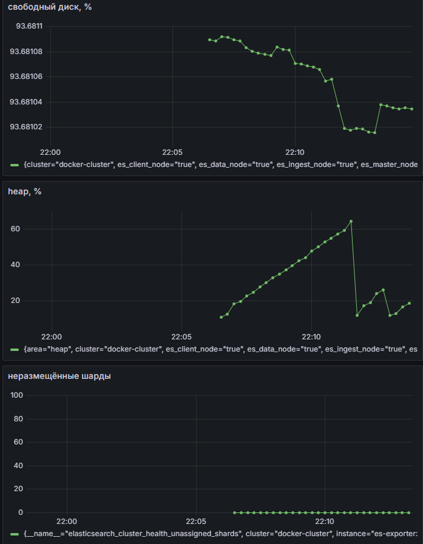

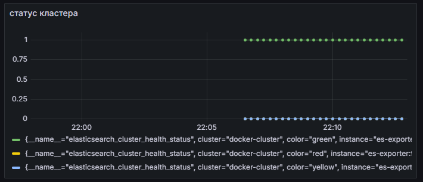

По графикам: в `000001` 40 документов, в `000002` ноль, ротация сработала. Heap дорос до 65% и упал до 15%, это Java почистила память. Диска свободно 93,7%, кластер green.

Для алертов я сначала выбрала статус и свободный диск, а третьим документы по индексу. Но документы растут при нормальной работе, на них непонятно какой порог ставить. Правильнее heap. Итого:

1. Статус кластера: red сразу, yellow если дольше 10 минут. Red значит часть логов недоступна.
2. Свободный диск меньше 20%. На 95% эластик переводит индексы в read-only и логи перестают писаться вообще.
3. Heap больше 85% дольше 5 минут. Когда память кончается, всё тормозит, запросы отклоняются, а эластик может упасть.

## Что в итоге

Эластик подняла, разобралась с цветами статуса, поискала по логам, ротацию настроила. Дольше всего разбиралась с заливкой логов и с тем, почему не создаётся новый индекс. Про refresh я до этой лабы вообще не знала.
