# Лабораторная работа 5. ELK: Elasticsearch + Kibana

Выполнили: Рекун Ирина, Костенко Кирилл, Ямалеева Азалия, группа К3320

## Цель

Поднять Elasticsearch и Kibana локально, залить логи приложения, научиться искать и агрегировать по ним, разобраться с шардами, репликами и статусом кластера, настроить ротацию индексов (ILM + rollover) и мониторинг.

## Как запустить

```bash
docker compose up -d
```

- Elasticsearch: http://localhost:9200
- Kibana: http://localhost:5601 (запросы выполнялись в Dev Tools → Console)
- Prometheus: http://localhost:9090
- Grafana: http://localhost:3000 (admin / admin), дашборд лежит в `monitoring/dashboard.json`

Залить тестовые логи:

```bash
tail -n +2 logs.ndjson | curl -s -X POST "localhost:9200/app-logs-alias/_bulk" \
  -H "Content-Type: application/x-ndjson" --data-binary @-
```

## Структура

```
lab5/
├── docker-compose.yml          # Elasticsearch, Kibana, экспортер, Prometheus, Grafana
├── logs.ndjson                 # 40 тестовых логов в формате bulk API
├── monitoring/
│   ├── prometheus.yml
│   ├── grafana/datasource.yml
│   └── dashboard.json
└── screenshots/
```

## Часть 1. Развёртывание ELK

Elasticsearch и Kibana версии 8.15.0 подняты через `docker compose`. Основные настройки Elasticsearch:

- `discovery.type=single-node` — кластер из одного узла, Elasticsearch не ищет другие узлы;
- `xpack.security.enabled=false` — отключены пароли и TLS. Это сделано только для удобства локальной лабы, **в проде так делать нельзя**;
- `ES_JAVA_OPTS=-Xms1g -Xmx1g` — ограничение памяти Java (heap) в 1 ГБ.

Kibana ждёт, пока Elasticsearch станет доступен (`depends_on` + `healthcheck`).

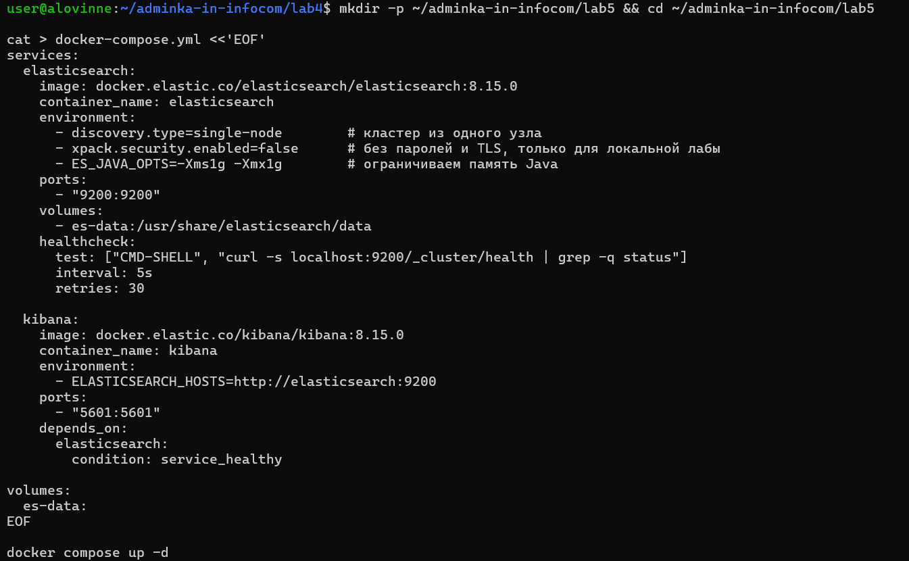

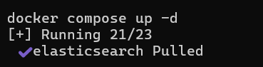

По адресу http://localhost:9200 Elasticsearch отвечает информацией о себе (версия 8.15.0, `"tagline": "You Know, for Search"`):

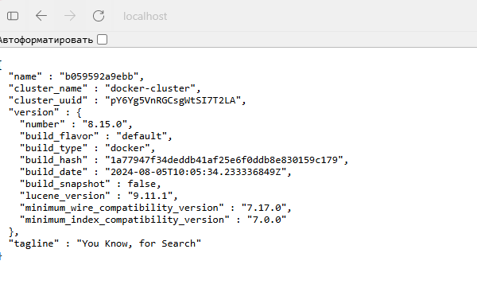

### Статус кластера

```
GET _cluster/health
```

Сразу после запуска статус был **green**, `number_of_nodes: 1`. В кластере были только служебные индексы Kibana, а они настроены так, что реплик у них столько, сколько позволяют узлы. На одном узле это 0, поэтому все шарды размещены.

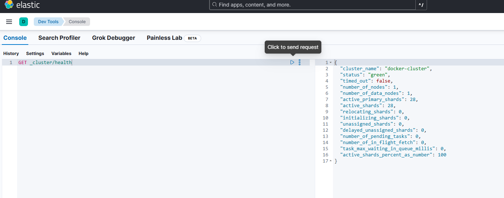

Чтобы проверить поведение обычного индекса, создали тестовый индекс с настройками по умолчанию (1 primary-шард, 1 реплика):

```
PUT test-index
GET _cluster/health
GET _cat/shards/test-index?v
```

Статус стал **yellow**, `unassigned_shards: 1`:

```
index      shard prirep state      node
test-index 0     p      STARTED    b059592a9ebb
test-index 0     r      UNASSIGNED
```

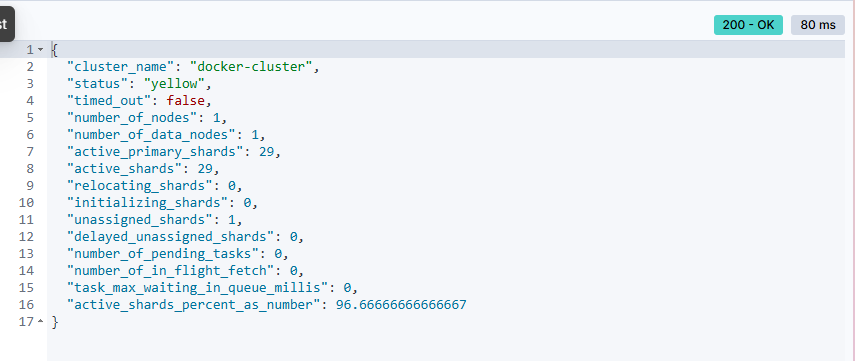

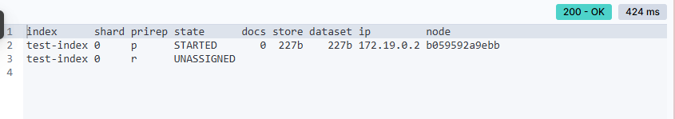

**Почему yellow на одном узле.** Индекс делится на primary-шарды, и у каждого могут быть реплики (копии). Elasticsearch никогда не ставит реплику на тот же узел, что и её primary: если узел упадёт, пропадут обе копии, и смысла в реплике нет. Второго узла нет, поэтому реплика остаётся неразмещённой (UNASSIGNED). Все данные доступны (primary на месте), но запасной копии нет — это и есть yellow.

- **green** — размещены все primary-шарды и все реплики;
- **yellow** — все primary размещены, но часть реплик нет;
- **red** — не размещён хотя бы один primary-шард, часть данных недоступна.

**Что нужно, чтобы стал green:**
1. Добавить в кластер второй узел — реплика разместится на нём. Это правильный вариант для прода.
2. Либо поставить индексу `number_of_replicas: 0`. Статус станет green, но запасной копии не будет, поэтому так можно делать только локально. Мы так и сделали для своих индексов, потому что узел один.

После проверки тестовый индекс удалили: `DELETE test-index`.

## Часть 2. Данные, индекс и поиск

### Логи

С помощью AI сгенерировали 40 логов за 27.10.2026 от четырёх сервисов (`api-gateway`, `auth-service`, `order-service`, `payment-service`) с уровнями INFO, WARN и ERROR. Некоторые `trace_id` повторяются в разных сервисах — как будто один запрос прошёл через несколько сервисов. Логи лежат в `logs.ndjson`.

Пример записи:

```json
{"timestamp": "2026-10-27T08:52:15Z", "level": "ERROR", "service": "payment-service", "message": "Payment declined by bank: insufficient funds", "trace_id": "trace-0002"}
```

### Маппинг

```
PUT app-logs
{
  "settings": {
    "number_of_shards": 1,
    "number_of_replicas": 0
  },
  "mappings": {
    "properties": {
      "timestamp": { "type": "date" },
      "level":     { "type": "keyword" },
      "service":   { "type": "keyword" },
      "message":   { "type": "text" },
      "trace_id":  { "type": "keyword" }
    }
  }
}
```

Почему такие типы:
- `text` разбивается на слова, поэтому подходит для полнотекстового поиска — это `message`;
- `keyword` хранится целиком, по нему можно точно фильтровать и строить агрегации — это `level`, `service`, `trace_id`;
- `date` нужен для фильтров по времени — это `timestamp`.

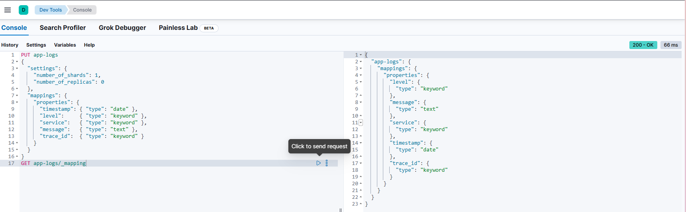

### Загрузка

Логи залили через bulk API: в формате bulk каждый документ занимает две строки — служебная `{"index": {}}` и сам документ. Так все записи отправляются одним запросом.

```bash
tail -n +2 logs.ndjson | curl -s -X POST "localhost:9200/app-logs/_bulk" \
  -H "Content-Type: application/x-ndjson" --data-binary @-
```

```
GET app-logs/_count   →   "count": 40
```

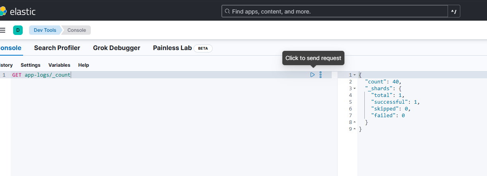

### Запросы

**Полнотекстовый поиск по `message`:**

```
GET app-logs/_search
{
  "query": { "match": { "message": "timeout" } }
}
```

Нашлось **4** лога: 2 «Database connection timeout while saving order» и 2 «Upstream payment-service timeout after 5000 ms». У каждого результата есть `_score` (релевантность): у более короткой строки он выше (2.07 против 1.92).


**Фильтр по `level = ERROR` и временному диапазону:**

```
GET app-logs/_search
{
  "query": {
    "bool": {
      "filter": [
        { "term":  { "level": "ERROR" } },
        { "range": { "timestamp": { "gte": "2026-10-27T12:00:00Z", "lte": "2026-10-27T18:00:00Z" } } }
      ]
    }
  }
}
```

Нашлось **8** логов. Здесь используется `filter`, а не `match`: условие точное («подходит или нет»), поэтому `_score` не считается, а результат кешируется — так быстрее.

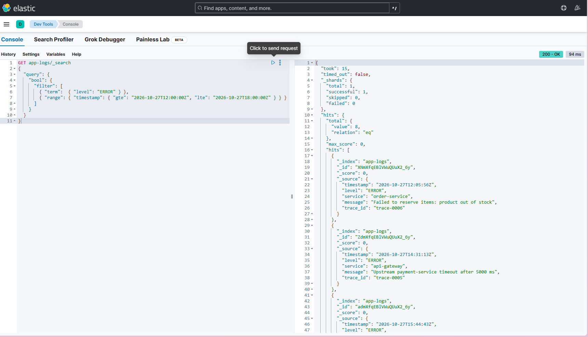

**Поиск по `trace_id`:**

```
GET app-logs/_search
{
  "query": { "term": { "trace_id": "trace-0002" } },
  "sort": [ { "timestamp": "asc" } ]
}
```

Нашлось **8** логов от разных сервисов. Так можно восстановить путь одного запроса через все сервисы и понять, где он упал.

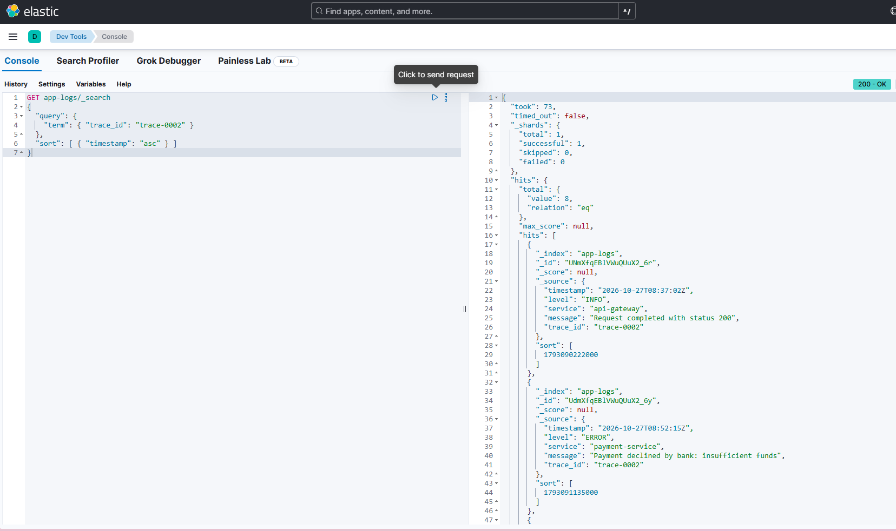

### Агрегация

```
GET app-logs/_search
{
  "size": 0,
  "aggs": {
    "by_level": { "terms": { "field": "level" } }
  }
}
```

Результат: **INFO — 17, ERROR — 14, WARN — 9**. `terms` группирует документы по значению поля, как `GROUP BY` в SQL, а `size: 0` убирает из ответа сами документы.

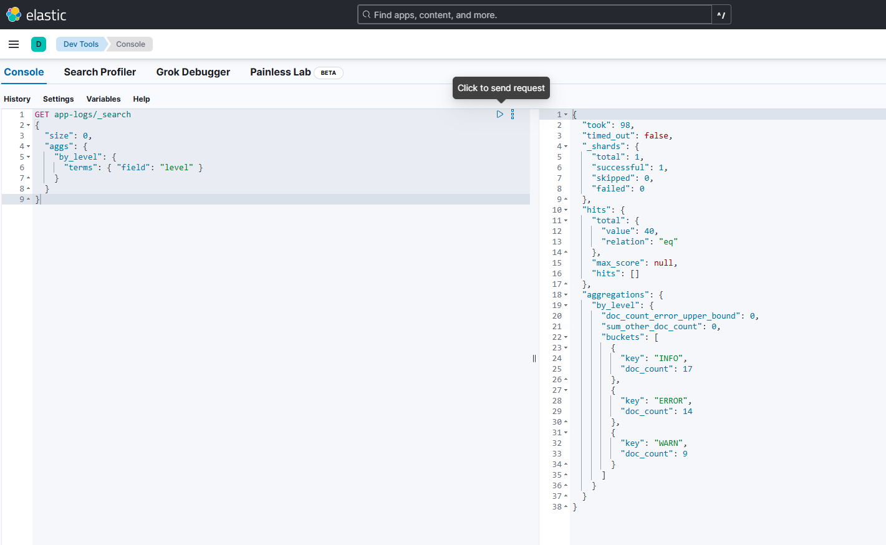

### Kibana

Создали data view `app-logs` с шаблоном `app-logs*` и полем времени `timestamp`. Звёздочка нужна, чтобы в data view попадали и индексы, созданные rollover (`app-logs-000001`, `app-logs-000002`, ...). В Discover за период Today видны все 40 логов.

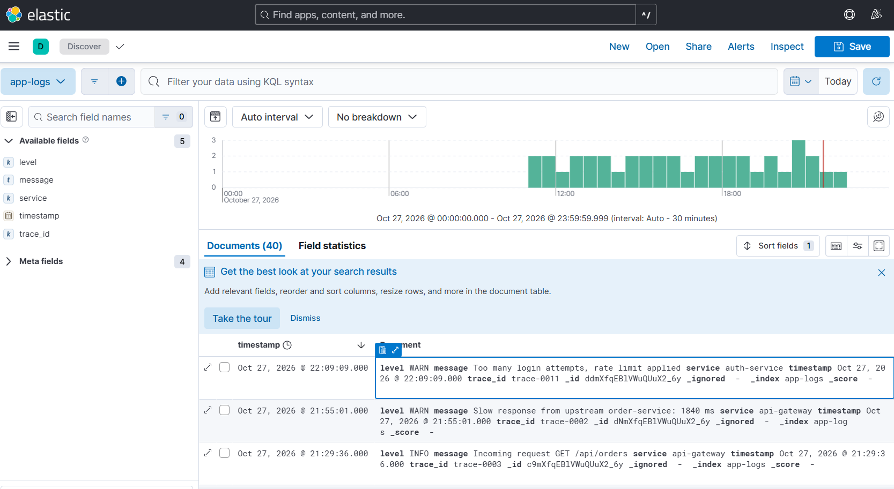

В Lens построили столбчатую диаграмму «Логи по уровням» (count по `level`) и добавили её на дашборд.

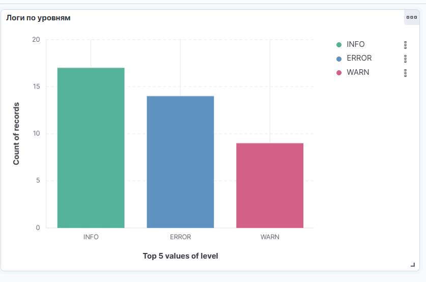

## Часть 3. ILM + rollover

Если писать логи в один индекс, он растёт без ограничений: поиск замедляется, а удалить старые логи можно только по документам, что очень медленно. Поэтому логи пишутся в цепочку индексов:

- **rollover** — когда текущий индекс достигает порога, создаётся новый, и запись переключается на него;
- **ILM** — политика, которая сама делает rollover и удаляет старые индексы целиком;
- приложение пишет в **alias**, который всегда указывает на текущий индекс для записи. После rollover alias переключается на новый индекс, а приложению ничего менять не нужно.

### ILM-политика

Для демонстрации порог маленький — 10 документов (или 1 день), удаление через 30 минут после rollover:

```
PUT _ilm/policy/app-logs-policy
{
  "policy": {
    "phases": {
      "hot": {
        "actions": {
          "rollover": { "max_docs": 10, "max_age": "1d" }
        }
      },
      "delete": {
        "min_age": "30m",
        "actions": { "delete": {} }
      }
    }
  }
}
```

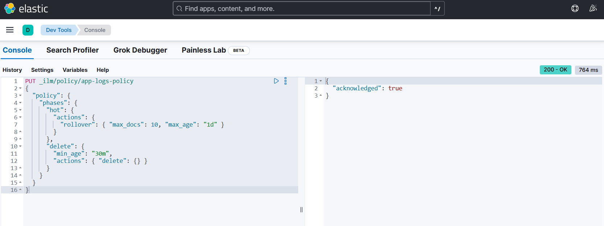

По умолчанию ILM проверяет условия раз в 10 минут, для демо уменьшили интервал:

```
PUT _cluster/settings
{
  "persistent": { "indices.lifecycle.poll_interval": "10s" }
}
```

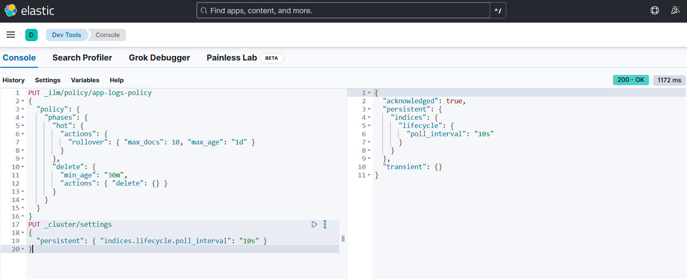

### Index template и alias

Шаблон применяет маппинг и ILM-политику к каждому новому индексу `app-logs-*`, в том числе к созданным rollover:

```
PUT _index_template/app-logs-template
{
  "index_patterns": ["app-logs-*"],
  "template": {
    "settings": {
      "number_of_shards": 1,
      "number_of_replicas": 0,
      "index.lifecycle.name": "app-logs-policy",
      "index.lifecycle.rollover_alias": "app-logs-alias"
    },
    "mappings": {
      "properties": {
        "timestamp": { "type": "date" },
        "level":     { "type": "keyword" },
        "service":   { "type": "keyword" },
        "message":   { "type": "text" },
        "trace_id":  { "type": "keyword" }
      }
    }
  }
}
```

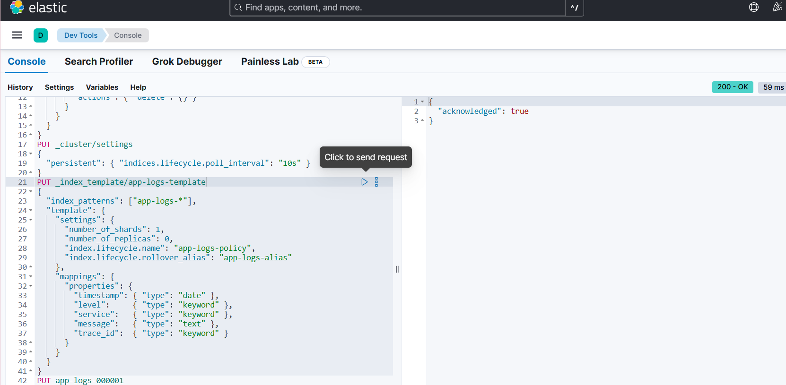

Первый индекс создали вручную и сделали его индексом для записи в alias. Номер `000001` нужен, чтобы rollover мог его увеличивать:

```
PUT app-logs-000001
{
  "aliases": {
    "app-logs-alias": { "is_write_index": true }
  }
}
```

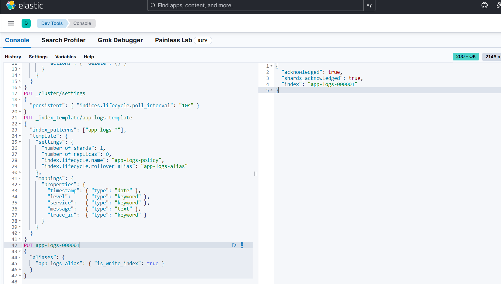

### Демонстрация

Залили 40 логов в **alias** `app-logs-alias`. Сначала rollover не сработал: в `_cat/indices` у `app-logs-000001` было `docs.count = 0`. Документы становятся видны только после refresh, а для индекса, по которому никто не ищет, Elasticsearch откладывает refresh. ILM видел 0 документов, это меньше порога, поэтому rollover не делал. В `_ilm/explain` в этот момент индекс `000001` был в фазе `hot` на шаге `check-rollover-ready` — то есть ILM ждал выполнения условия rollover:

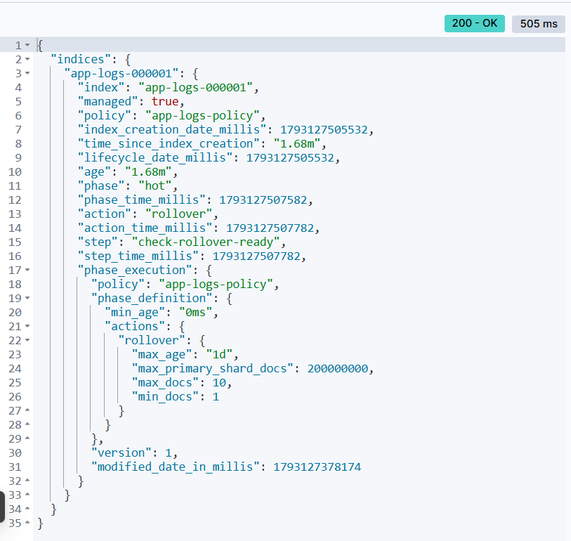

После принудительного refresh:

```
POST app-logs-alias/_refresh
```

у `000001` стало 40 документов, и при следующей проверке ILM сделал rollover:

```
GET _cat/indices/app-logs*?v&s=index

health status index            pri rep docs.count
green  open   app-logs           1   0         40
green  open   app-logs-000001    1   0         40
green  open   app-logs-000002    1   0          0
```

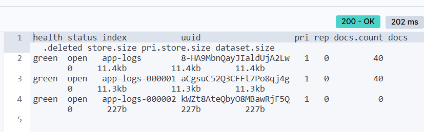

Теперь `app-logs-alias` указывает на `app-logs-000002` (`is_write_index: true`), а у `000001` стало `false`, и новые логи пишутся в `000002`:

```
GET _alias/app-logs-alias
```

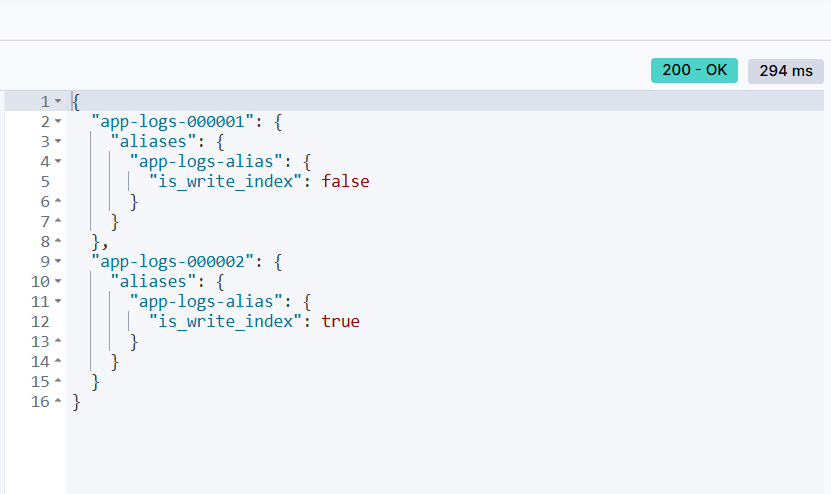

 Через 30 минут после rollover `app-logs-000001` удаляется фазой `delete`.

## Часть 4. Мониторинг

Elasticsearch не отдаёт метрики в формате Prometheus, поэтому поставили **elasticsearch_exporter**. Он опрашивает API Elasticsearch (`_cluster/health`, `_nodes/stats`, статистику индексов) и отдаёт метрики Prometheus. **Prometheus** собирает их каждые 10 секунд, **Grafana** рисует дашборд.

Флаги экспортера: `--es.all` — метрики со всех узлов, `--es.indices` — метрики по каждому индексу.

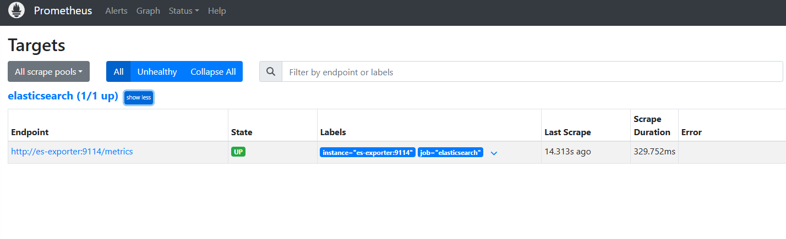

### Дашборд

| Панель | Запрос | Зачем |
|---|---|---|
| Статус кластера | `elasticsearch_cluster_health_status` | green / yellow / red |
| Неразмещённые шарды | `elasticsearch_cluster_health_unassigned_shards` | почему кластер не green |
| Heap, % | `elasticsearch_jvm_memory_used_bytes{area="heap"} / elasticsearch_jvm_memory_max_bytes{area="heap"} * 100` | запас памяти Java |
| Свободный диск, % | `elasticsearch_filesystem_data_available_bytes / elasticsearch_filesystem_data_size_bytes * 100` | запас места до watermarks |
| Документы по индексам | `elasticsearch_indices_docs_primary{index=~"app-logs.*"}` | видно, как работает rollover |
| Скорость записи | `rate(elasticsearch_indices_indexing_index_total[1m])` | нагрузка на запись |

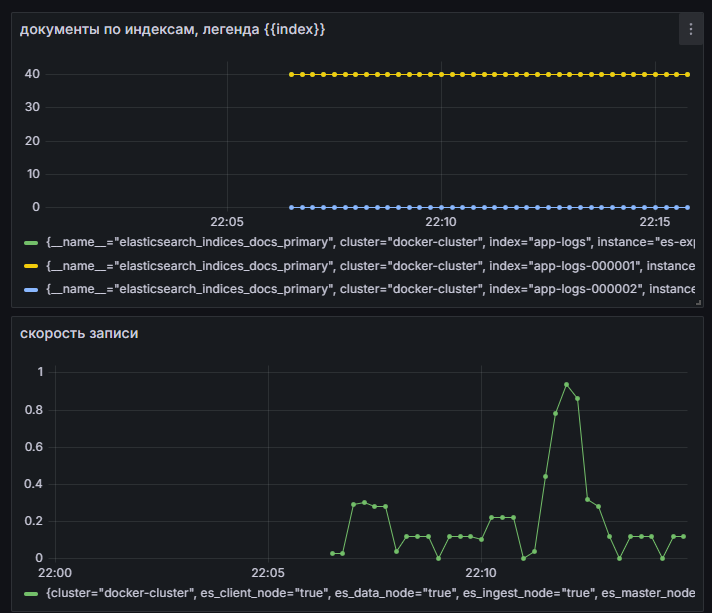

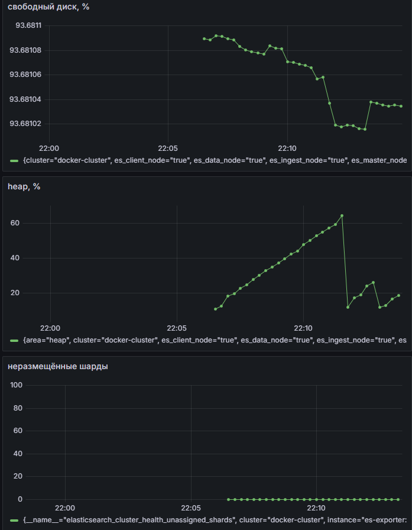

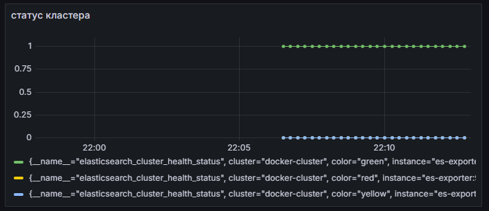

Что видно на дашборде:
- **документы по индексам:** в `app-logs` и `app-logs-000001` по 40 документов, в `app-logs-000002` — 0, то есть rollover отработал, и новый индекс ждёт записи;
- **скорость записи** поднимается во время заливки логов и падает после;
- **heap** рос примерно до 65%, а потом резко упал до ~15% — это сработала сборка мусора Java (GC);
- **свободный диск** около 93,7%, запас большой;
- **неразмещённых шардов** 0, **статус кластера** green (1 у `color="green"`, 0 у остальных цветов).

### 3 метрики для алертов

1. **Статус кластера** — `red` сразу, `yellow` дольше 10 минут. `red` значит, что потерян primary-шард: часть логов недоступна, а в этот индекс нельзя писать. `yellow` менее срочно: данные на месте, но без запасной копии, и падение ещё одного узла может их потерять.

2. **Свободный диск < 20%.** У Elasticsearch есть пороги заполненности диска: на 85% он перестаёт размещать новые шарды на узле, на 90% начинает переносить шарды, а на 95% переводит индексы в **read-only**, и запись логов полностью останавливается. Алерт заранее даёт время почистить индексы или добавить место.

3. **Heap > 85% дольше 5 минут.** Elasticsearch держит в heap кеши, буферы и данные агрегаций. Когда heap заполнен, Java постоянно запускает сборку мусора и Elasticsearch тормозит, срабатывают circuit breakers и запросы начинают отклоняться, а в худшем случае узел падает с OutOfMemoryError.

Число документов и скорость записи на алерт не ставим: они меняются при нормальной работе (ILM регулярно ротирует индексы), и непонятно, какой порог считать аварией. Их полезно видеть на дашборде.

## Вывод

Мы развернули Elasticsearch и Kibana в docker compose, разобрались со статусами кластера: на одном узле индекс с репликой получает статус yellow, потому что реплику нельзя разместить на том же узле, что и primary. Создали индекс с маппингом для логов, залили данные через bulk API, выполнили полнотекстовый поиск, фильтры по уровню, времени и trace_id, агрегацию и построили визуализацию в Kibana. Настроили ILM-политику с rollover и удалением, index template и alias и показали, что после превышения порога создаётся новый индекс. Также настроили мониторинг через elasticsearch_exporter, Prometheus и Grafana и выбрали 3 метрики для алертов: статус кластера, свободный диск и заполненность heap.
